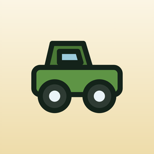
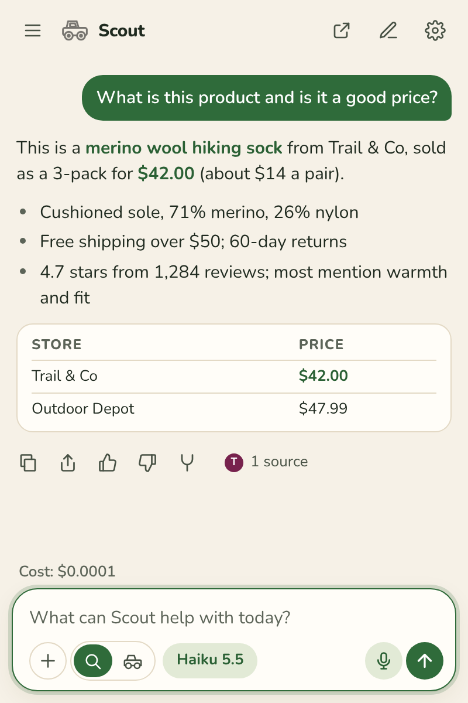
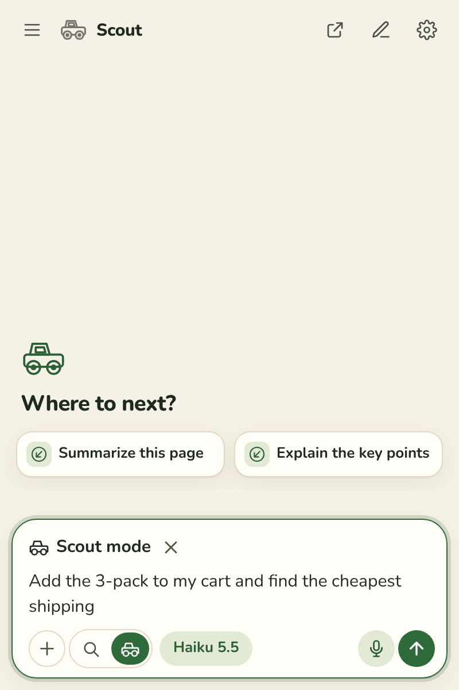
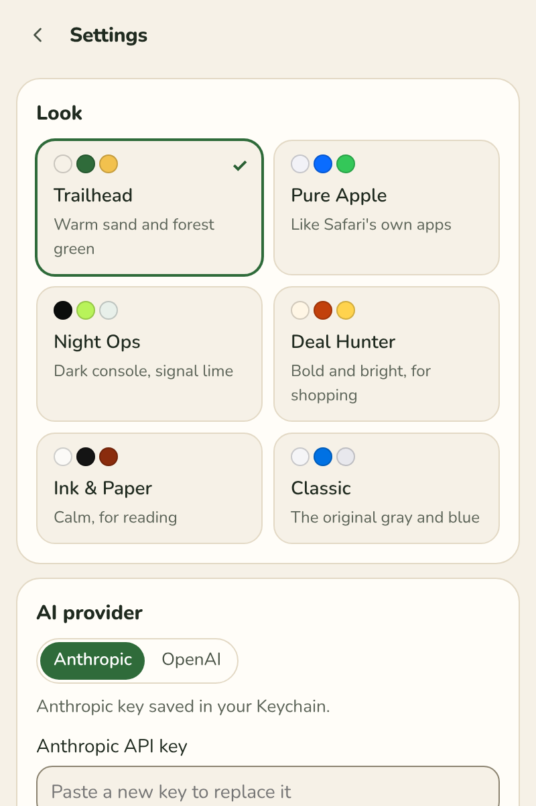
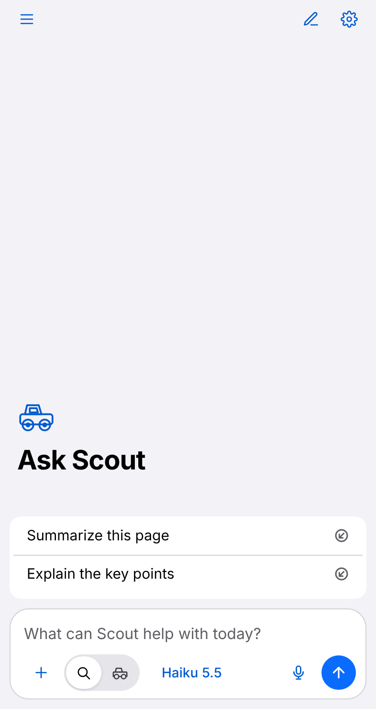
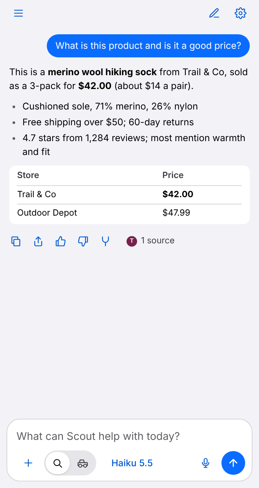
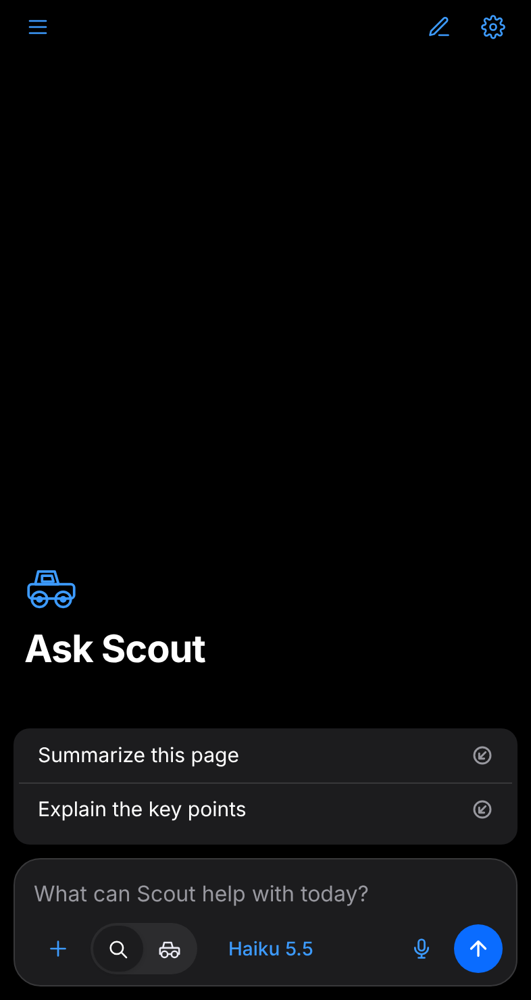
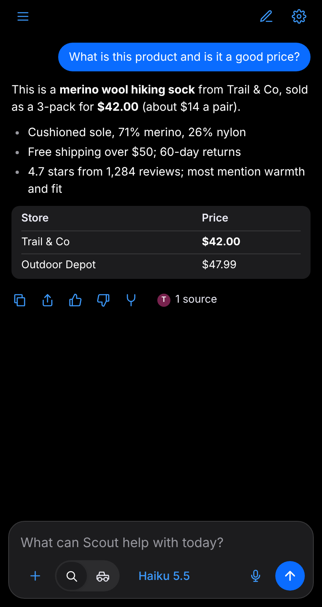
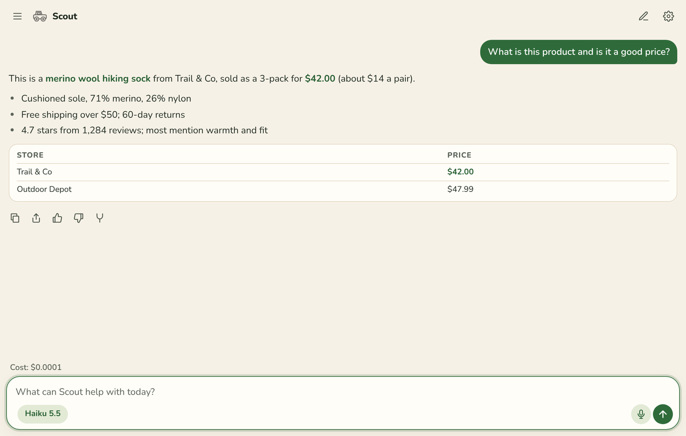

<p align="center">
  
</p>

# Scout AI Assistant

Your AI assistant in the browser: summarize pages, ask questions, compare tabs, fill forms and find coupons with your own AI key.

Scout works in Safari on Mac, iPhone and iPad today. Chrome and Firefox
versions are built from the same code and are coming soon. (Formerly Scout for
Safari.)

## Screenshots

On the Mac, Scout opens in the Trailhead look. These follow your system's light
or dark setting, so GitHub shows the one that matches yours.

| Ask about the page | Scout mode | Settings > Look |
| --- | --- | --- |
| <picture><source media="(prefers-color-scheme: dark)" srcset="docs/screenshots/mac-dark-answer.png"></picture> | <picture><source media="(prefers-color-scheme: dark)" srcset="docs/screenshots/mac-dark-scout-mode.png"></picture> | <picture><source media="(prefers-color-scheme: dark)" srcset="docs/screenshots/mac-dark-settings.png"></picture> |

On iPhone and iPad, Scout starts in the Pure Apple look:

| Light | Dark |
| --- | --- |
|   |   |

Scout also opens as a full page in its own tab:

<picture>
  <source media="(prefers-color-scheme: dark)" srcset="docs/screenshots/mac-dark-full-page.png">
  
</picture>

The screenshots show made-up pages and answers. They were captured in Chromium
on Linux with the repo's review tooling (`impeccable-review/tools/panel.capture.ts`),
so Inter and Nunito stand in for Apple's system fonts.

## What it does

A Web Extension opened from the Scout truck button in the toolbar (on iPhone
and iPad, from the page menu). It uses your own Anthropic or OpenAI API key,
kept in your Keychain on Safari and in the browser's local extension storage
on Chrome and Firefox. There is no Scout server.

- **Chat** about anything. When a question is about the page you are on,
  Scout uses the page; otherwise it answers like any chat window.
- **Summarize** a page, or ask across other open tabs.
- **Scout mode**: a supervised agent that carries out a task on the page for
  you, step by step, under a glowing page with Take control and Stop. Sending
  a task starts it at once; before anything sensitive (buying, sending, signing in,
  deleting, submitting, downloading) it asks, every time.
- **Find coupons** on a cart or checkout page: searches the live web for codes
  posted for that store (coupon sites, creators, the store's own pages), keeps
  each code's page as evidence, tests every code in your cart one at a time,
  and leaves the best verified discount applied. It never guesses codes and
  never checks out.
- **Settings**: pick the model, effort level and look.

Each tab keeps its own conversation. Scout works in Private Browsing; chats in a
private tab are deleted when the tab closes. Settings > Permissions lists every
permission with its default; all of them are enforced on the device.
Shortcut on Mac: Control-Shift-S opens and closes it.

## Install

Scout isn't in the App Store, Chrome Web Store or Firefox Add-ons yet. Until
then, build it from source. Every build starts with:

```sh
npm ci
```

### Safari on Mac (macOS 14 or later)

Needs Xcode.

```sh
scripts/build-mac.sh
```

This builds the extension and the Mac app, signs it (with your Apple
Development certificate if you have one, otherwise ad-hoc) and registers it
with Safari. Then turn on Scout AI Assistant in Safari > Settings > Extensions.
With an ad-hoc build, Safari needs "Allow unsigned extensions" (in its
developer settings) turned on again after each restart.

### Safari on iPhone and iPad (iOS 17 or later)

Needs Xcode and an Apple development team. With the device connected:

```sh
scripts/build-ios.sh
```

It builds, signs and installs the app (`SCOUT_IOS_DEVICE` picks a device when
more than one is connected). Then turn Scout on in Settings > Apps > Safari >
Extensions. You can also open `apple/SafariScout.xcodeproj` and run the
"Scout for Safari (iOS)" scheme.

### Chrome and Firefox (coming soon)

Store listings are on the way. To try a local build now:

- **Chrome** (120 or later): `npm run build:chrome`, then open
  `chrome://extensions`, turn on Developer mode, choose Load unpacked and pick
  the `dist/chrome` folder.
- **Firefox** (140 or later): `npm run build:firefox`, then open
  `about:debugging`, choose This Firefox > Load Temporary Add-on and pick
  `dist/firefox/manifest.json`.

Each build also makes a store zip at `dist/scout-<browser>-<version>.zip`.

Once it's installed, open Scout, add your Anthropic or OpenAI API key in
Settings, and ask away.

## Dark mode

Scout follows your system's light or dark appearance, the same way Safari does.
There is no separate switch: every look (Trailhead, Pure Apple, Night Ops, Deal
Hunter, Ink & Paper and Classic) has a light and a dark version, and the panel
changes the moment your system does. The toolbar button swaps to a matching
light or dark icon too. Pick a look in Settings > Look. Trailhead is the
default on Mac (and on Chrome and Firefox), Pure Apple on iPhone and iPad.

## Build and test

| Check | Command |
| --- | --- |
| Unit tests | `npm test` |
| Types / lint | `npm run typecheck`, `npm run lint` |
| Extension bundle | `npm run build` |
| Chrome / Firefox store packages | `npm run build:chrome`, `npm run build:firefox` (release; `dist/<browser>/` and `dist/scout-<browser>-<version>.zip`) |
| End-to-end (WebKit) | `PLAYWRIGHT_BROWSERS_PATH=.cache/ms-playwright npx playwright test` |
| Release bundle has no debug code | `npm run check:release` |
| Old name fully removed | `npm run check:rename` |
| App Store screenshot sizes | `npm run check:screenshots` |
| Toolbar icons from `design/icons/` | `node scripts/render-toolbar-icons.mjs` |
| Mac app (signed, registered with Safari) | `scripts/build-mac.sh` |
| iPhone / iPad app (installed on a connected device) | `scripts/build-ios.sh` |

Xcode project: `apple/SafariScout.xcodeproj` (schemes "Scout for Safari (macOS)",
"Scout for Safari (iOS)", `SafariScoutTests`, `SafariScoutUITests`). More detail
in `CLAUDE.md`, `prd.md`, and `docs/`.

## Privacy and contact

There is no Scout server: your questions go from your browser straight to the
AI provider whose key you add. Privacy policy:
https://rarecreatures.app/apps/scout/privacy/

Made by Rare Creatures LLC. Questions or feedback: hello@rarecreatures.app ·
https://rarecreatures.app
